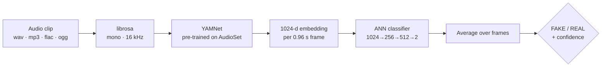
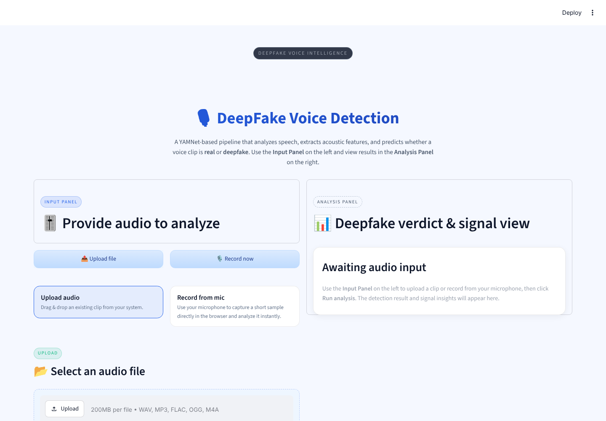
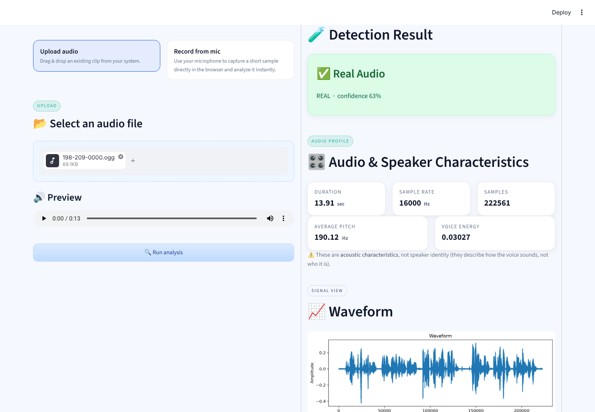
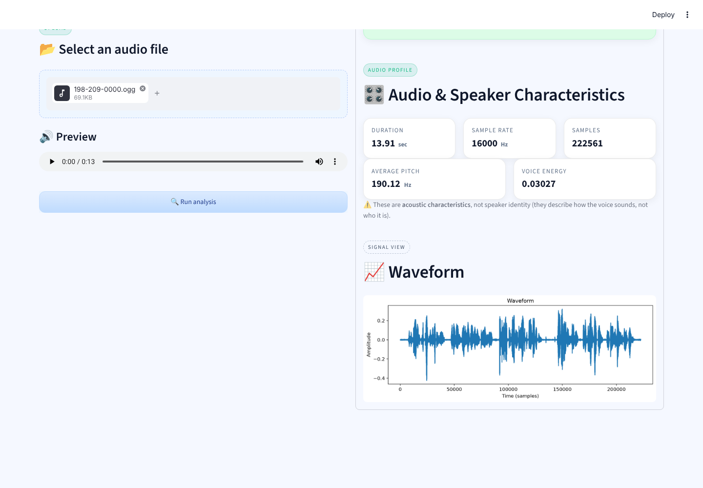
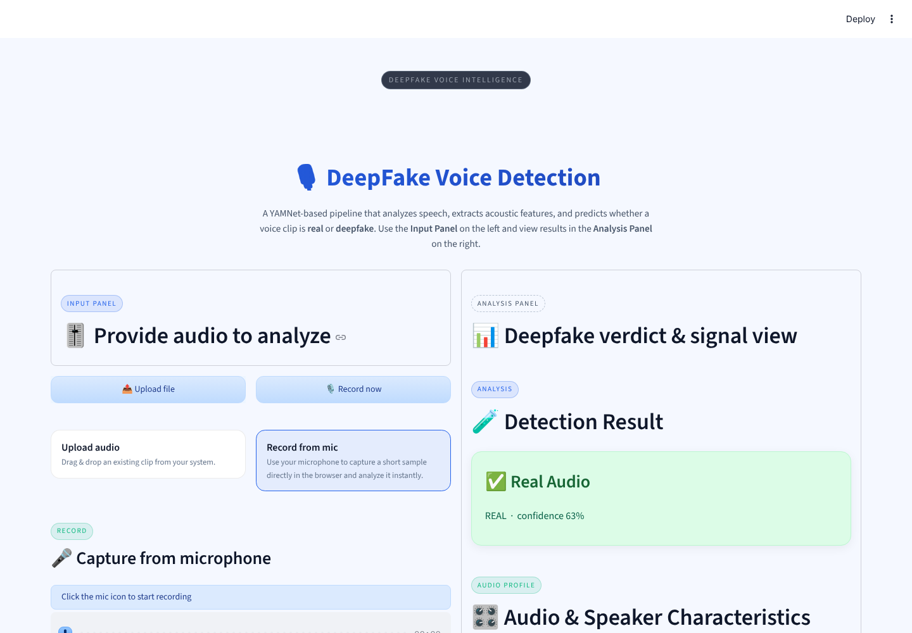
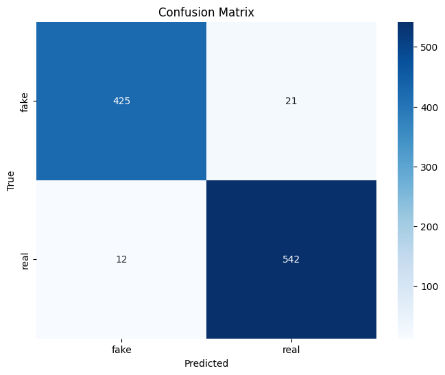
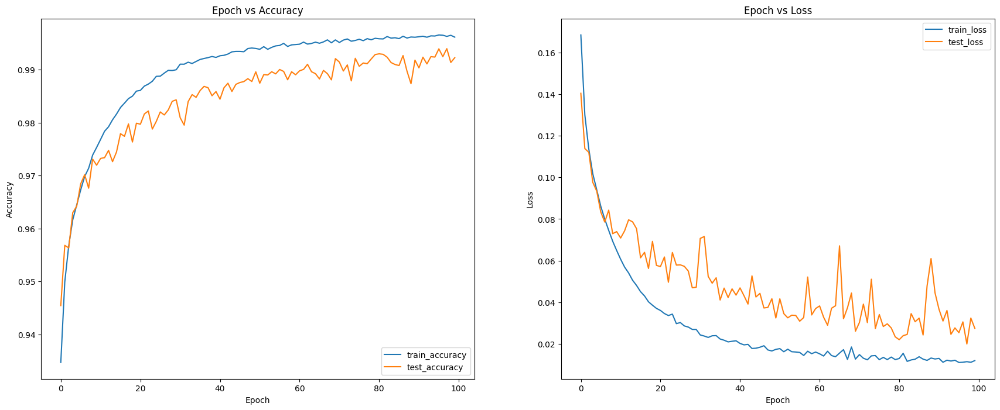

<h1 align="center">🎙️ AI-Powered Voice Anti-Spoofing Detection</h1>

<p align="center">
  Detects whether a voice clip is <b>genuine human speech</b> or a <b>deepfake / synthetic voice</b>,<br/>
  using <b>YAMNet</b> audio embeddings and a lightweight neural classifier, served with <b>FastAPI</b> and <b>Streamlit</b>.
</p>

<p align="center">
  🏆 <b>Winner, VOIS Innovation Marathon 2.0 (₹2,00,000)</b>
</p>

<p align="center">
  
  
  
  
  
  
  
</p>

---

## 📌 Overview

Voice-based authentication and phone banking are vulnerable to **AI-cloned voices** and **replay attacks**. This system takes an audio clip, from an upload or the microphone, and predicts **REAL** or **FAKE** with a confidence score. It also shows the clip's acoustic profile: duration, pitch, energy and waveform.

## 🏗️ How it works



- **Dataset:** **In-the-Wild Audio Deepfake** (Kaggle: `in-the-wild-audio-deepfake`). It contains 31,779 clips (11,816 fake and 19,963 real) of real public figures and their deepfakes, which yield 266,945 YAMNet frames.
- **Models compared:** ANN, 1D-CNN and CNN + BiLSTM, all on YAMNet embeddings. The **ANN** was deployed because it had the best accuracy and the smallest size (395 K parameters).
- **Serving:** the full pipeline (YAMNet + ANN) is exported as one TensorFlow SavedModel (`API/app/src/artifact/ann_human_or_bot`), which takes a raw waveform and returns class probabilities.

---

## 📸 Screenshots

| Home: input and analysis panels | Detection result with confidence |
|---|---|
|  |  |

| Audio profile and waveform | Record from microphone |
|---|---|
|  |  |

---

## 🚀 How to run

> TensorFlow 2.15 needs **Python 3.10 or 3.11**.

```bash
git clone https://github.com/ChetanyaB/AI_Powered_Voice_AntiSpoofing_Detection.git
cd AI_Powered_Voice_AntiSpoofing_Detection/API

python -m venv venv
venv\Scripts\activate            # Windows
# source venv/bin/activate       # Linux / macOS

pip install -r requirements.txt
```

**Streamlit app**

```bash
streamlit run streamlit_app.py
```

Upload a `.wav / .mp3 / .flac / .ogg / .m4a` file, or switch to **Record now** and use your microphone. Sample clips are in [`API/samples/`](API/samples).

**REST API**

```bash
python main.py                    # http://localhost:8000/docs
curl -F "audio_file=@samples/real/198-209-0000.ogg" http://localhost:8000/depfake
# {"status":1,"Message":"REAL","scores":{"FAKE":0.3736,"REAL":0.6264}}
```

**Tests**

```bash
pytest -v                         # from the API/ folder
python evaluate_samples.py        # out-of-domain sanity check
```

---

## 📊 Evaluation

### Test set results (In-the-Wild dataset, from the training notebook)

These are the results on a held-out test split of 1,000 YAMNet frames.

| Model | Accuracy | Precision (fake) | Recall (fake) | F1 (fake) | Precision (real) | Recall (real) | F1 (real) | Parameters |
|---|---|---|---|---|---|---|---|---|
| **ANN (deployed)** | **0.97** | 0.97 | 0.95 | 0.96 | 0.96 | 0.98 | 0.97 | 0.4 M |
| 1D-CNN | 0.97 | 0.97 | 0.96 | 0.97 | 0.97 | 0.97 | 0.97 | 8.4 M |
| CNN + BiLSTM | 0.94 | 0.94 | 0.93 | 0.94 | 0.94 | 0.95 | 0.95 | 33.9 M |

| ANN confusion matrix | ANN training curves |
|---|---|
|  |  |

## ✅ Test case scenarios

| # | Scenario | Expected result | Status |
|---|---|---|---|
| TC01 | `GET /` health check | `{"Fast API": "API is working"}` | ✅ Pass |
| TC02 | `POST /depfake` with a real and a synthetic clip | `status 1`, label FAKE/REAL, scores summing to 1 | ✅ Pass |
| TC03 | Corrupt or non-audio upload | Readable error message (was an empty `{}` before) | ✅ Pass |
| TC04 | `.wav` and `.ogg` input | Both classified | ✅ Pass |
| TC05 | Stereo 44.1 kHz input | Down-mixed and resampled to 16 kHz mono; duration correct | ✅ Pass |
| TC06 | Very short clip (0.5 s) | Still classified, no crash | ✅ Pass |
| TC07 | Same clip twice | Identical scores (deterministic) | ✅ Pass |
| TC08 | Acoustic profile | Average pitch in the human range (60–300 Hz), energy > 0 | ✅ Pass |
| TC09 | Microphone recording | Goes through the model; no hard-coded result | ✅ Pass |

Full output: [`docs/test_results.txt`](docs/test_results.txt).

## 🗂️ Project structure

```
├── API/
│   ├── streamlit_app.py           # Streamlit UI (upload + microphone)
│   ├── main.py                    # Starts the FastAPI server
│   ├── app/app.py                 # REST endpoint POST /depfake
│   ├── app/src/deepfake.py        # Inference (YAMNet + ANN SavedModel)
│   ├── app/src/artifact/ann_human_or_bot/   # Exported model
│   ├── samples/                   # Real and synthetic test clips
│   ├── evaluate_samples.py        # Out-of-domain sanity check
│   └── tests/test_api.py          # 10 automated test cases
├── deepfake-voice-clasification-yamnet-2.ipynb   # Training and evaluation notebook
├── Project Presentation VOIS Marathon2.0.pptx
├── Hackathon_ProblemStatement.pdf
└── docs/                          # Screenshots, evaluation plots, test log
```

## 🛠️ Tech stack

`Python` · `TensorFlow / Keras` · `TensorFlow Hub (YAMNet)` · `librosa` · `FastAPI` · `Streamlit` · `scikit-learn` · `pytest`

